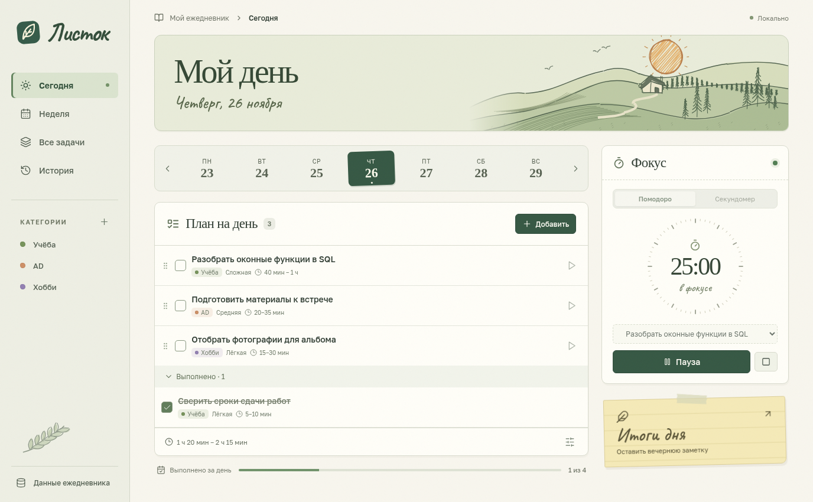

# Листок

Личный ежедневник для ПК. Задачи привязаны к дню и расположены в твоём порядке.



## Запуск через Docker Compose

Для запуска выполни команду из папки проекта.

```sh
docker compose up -d --build
```

Открой [Листок](http://127.0.0.1:5173/) в браузере. Если запущен `npm run dev`, сначала останови его через Ctrl+C, чтобы освободить порт. Для остановки контейнера выполни `docker compose down`. Задачи сохранятся в браузере.

Если в Linux контейнер сборки не может обратиться к npm через DNS, используй сеть хоста для этапа сборки.

```sh
docker build --network=host -t listok-planer:local .
docker compose up -d --no-build
```

## Запуск для разработки

Понадобятся Node.js 22.12+ и npm.

```sh
npm ci
npm run dev
```

Открой http://127.0.0.1:5173 в своём обычном браузере. При следующих запусках достаточно `npm run dev`. Закрыть сервер можно с помощью Ctrl+C.

## Как пользоваться

- **Сегодня.** Добавь задачу. Название обязательно, остальные поля можно заполнить позже. Перетащи задачу за точки слева или используй стрелки в строке. Кнопка рядом с суммой оценок задаёт ориентир нагрузки.
- **Неделя.** Перетащи задачу в нужный день или в «Без даты». Для переноса на дальнюю дату открой карточку и измени день. Крупную задачу можно разбить на шаги и распланировать их отдельно.
- **Все задачи.** Найди дело по названию, категории, сложности или наличию даты. Плюс рядом с категориями создаёт свою категорию.
- **Фокус.** Выбери задачу или свободную сессию. Помодоро длится 25 минут, после него доступен пятиминутный перерыв. Секундомер считает вверх. Можно поставить сессию на паузу. При закрытии вкладки время продолжает идти, при открытии завершившийся интервал будет учтён.
- **Итоги дня.** Сохрани заметки, распоряжение незавершёнными делами и первую задачу на завтра. Записи доступны в истории.

## Хранение

Приложение сохраняет изменения в IndexedDB текущего профиля браузера. Используй один адрес и порт: браузер хранит данные для `localhost` и `127.0.0.1` отдельно. У каждой вкладки того же адреса общий ежедневник. Для переноса на другой компьютер или в другой браузер открой **Данные ежедневника**, скачай копию и восстанови её в новом месте. Очистка данных сайта удаляет локальный ежедневник.

## Сборка

`npm run build` проверяет типы и собирает статический сайт в `dist/`. Для просмотра сборки используй `npm run preview`. Шрифты, иллюстрации и иконки входят в сборку.
